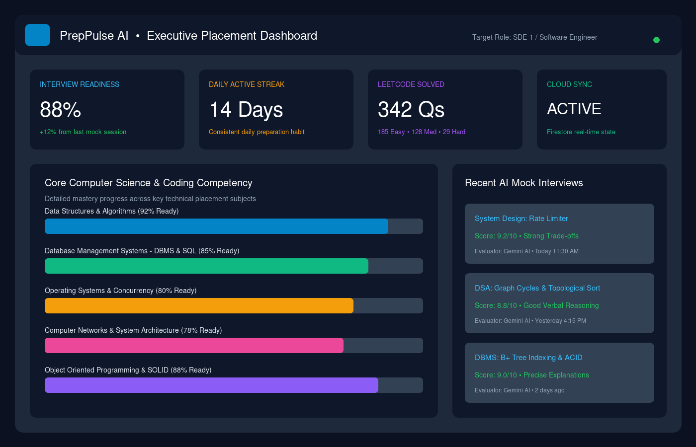
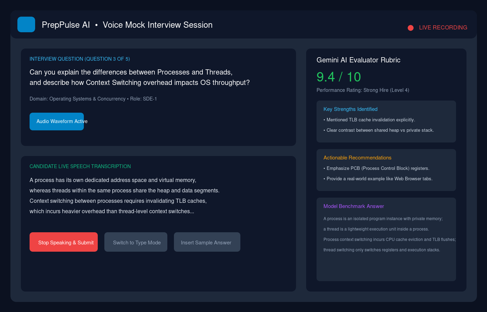
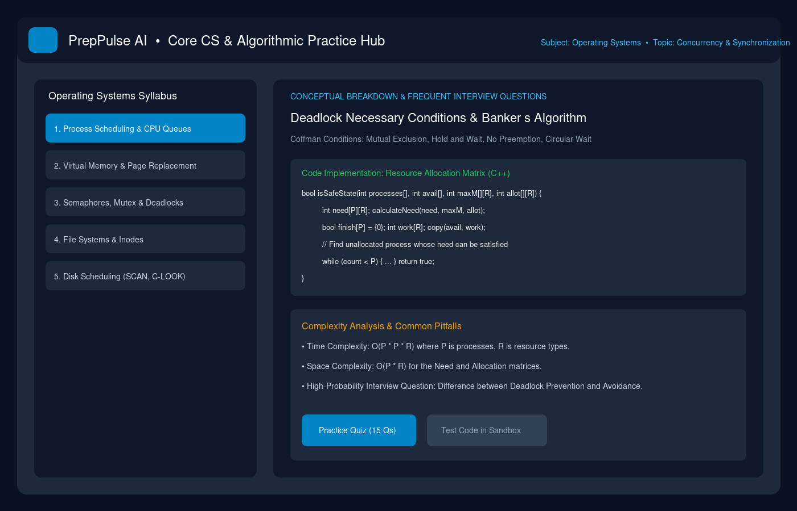
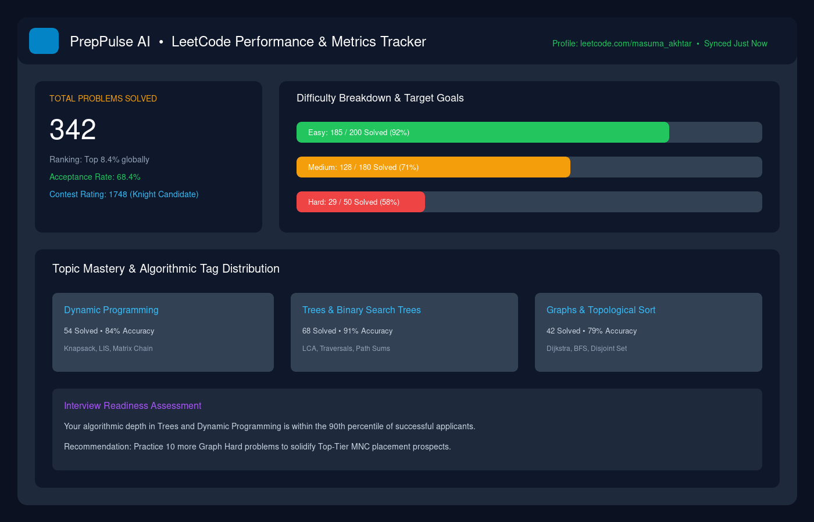
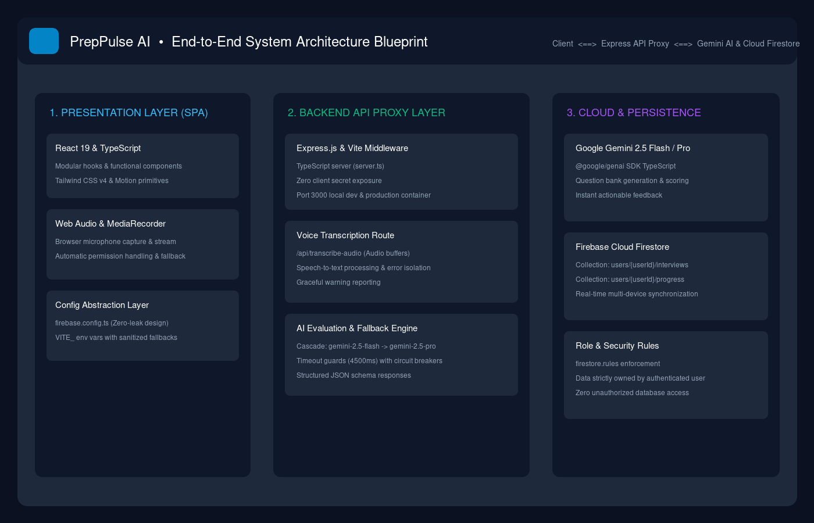
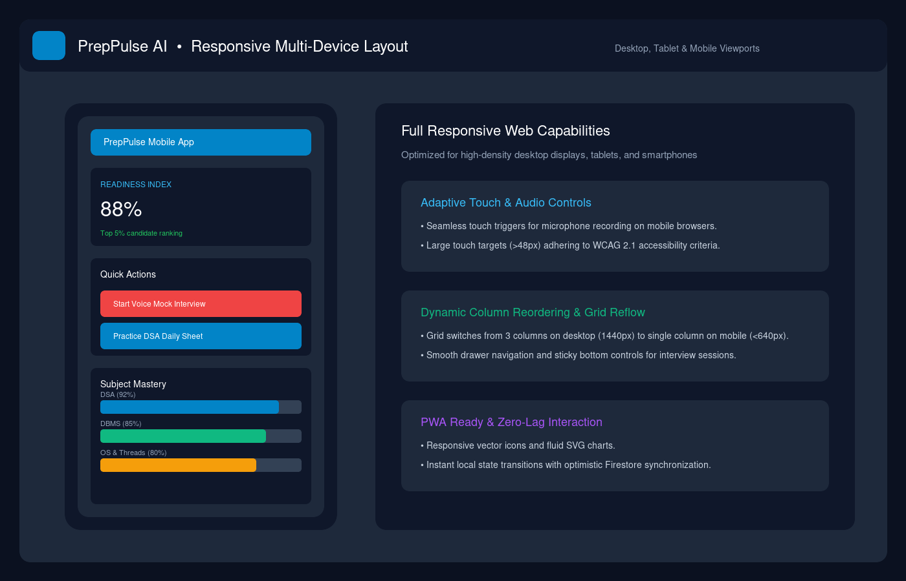

# PrepPulse AI — Tech Placement & Mindset Hub
### 🎓 B.Tech Computer Science & Engineering — Major Project Submission

[](https://react.dev/)
[](https://www.typescriptlang.org/)
[](https://tailwindcss.com/)
[](https://ai.google.dev/)
[](https://firebase.google.com/)
[](https://opensource.org/licenses/MIT)

> **PrepPulse AI** is an integrated placement intelligence and mock interview platform developed as a final-year university Major Project. It bridges the gap between academic theory and high-stakes tech hiring through real-time voice mock interviews powered by Google Gemini AI, comprehensive Core Computer Science curricula (OS, DBMS, CN, OOP), live LeetCode progress tracking, and secure Cloud Firestore synchronization.

---

## 📑 Table of Contents

- [Overview & Key Features](#-overview--key-features)
- [Project Output Screenshots](#-project-output-screenshots)
- [System Architecture](#-system-architecture)
- [Major Project Documentation & Presentation](#-major-project-documentation--presentation)
- [Repository File Structure](#-repository-file-structure)
- [Tech Stack](#-tech-stack)
- [Quick Start & Installation](#-quick-start--installation)
- [Environment Configuration](#-environment-configuration)
- [Security & GitHub Publishing](#-security--github-publishing)
- [Academic Credits & License](#-academic-credits--license)

---

## 🚀 Overview & Key Features

### 1. 🎙️ AI Voice Mock Interview Engine
- **Conversational Speech Input**: Live voice recording via Web Audio and MediaRecorder with server-side speech-to-text processing.
- **Rubric Scoring (0–10)**: Evaluates technical depth, communication clarity, and edge cases using Google Gemini 2.5 Flash with automatic fallback cascades.
- **Adaptive Fallback**: Gracefully shifts to typed responses with one-click sample responses if microphone access is blocked.
- **Actionable Critique**: Pinpoints candidate strengths, specific improvement targets, and ideal benchmark answers.

### 2. 📚 Core Computer Science & Algorithmic Practice Hub
- **Operating Systems**: Processes vs Threads, CPU scheduling, Virtual memory, Semaphores, and Deadlocks (Banker's Algorithm).
- **Database Management Systems**: Relational schema design, Normalization (1NF–BCNF), Indexing (B+ Trees), and ACID transactions.
- **Computer Networks**: OSI vs TCP/IP protocols, 3-way handshake, DNS lookup flow, and socket programming.
- **Object-Oriented Programming**: SOLID design principles, design patterns (Singleton, Factory, Observer), and encapsulation.
- **DSA Code Sandbox**: Curated algorithmic problems with time/space complexity notes ($O(N)$, $O(P^2 \times R)$) and quizzes.

### 3. 📊 LeetCode Sync & Executive Analytics
- **Live Handle Aggregation**: Scrapes and synchronizes LeetCode problem-solving stats across Easy, Medium, and Hard tiers.
- **Readiness Index**: Dynamic algorithm combining DSA completion, mock interview marks, and daily consistency streaks.
- **Algorithmic Tag Radar**: Visualizes topic depth across Dynamic Programming, Trees, Graphs, and Greedy techniques.

### 4. ☁️ Real-Time Persistence & Security
- **Firebase Authentication**: Guest and Google sign-in options.
- **Cloud Firestore**: Real-time cross-device data synchronization.
- **Zero-Leak Configuration**: Modular config abstraction layer (`firebase.config.ts`) protecting secret keys during open-source GitHub publishing.

---

## 📸 Project Output Screenshots

All high-resolution outputs are available in the [`screenshots/`](./screenshots/) directory:

| 1. Executive Placement Dashboard | 2. Voice Mock Interview with AI Rubric |
| :---: | :---: |
| [](./screenshots/01_executive_dashboard.png) | [](./screenshots/02_voice_mock_interview.png) |
| *Readiness Index, 14-day streak & subject mastery* | *Live voice waveform, transcription & Gemini scoring* |

| 3. Core CS & DSA Practice Hub | 4. LeetCode Metrics Tracker |
| :---: | :---: |
| [](./screenshots/03_dsa_core_cs_module.png) | [](./screenshots/04_leetcode_tracker.png) |
| *Operating Systems, DBMS, CN & interactive code sandbox* | *Live difficulty ratios & algorithmic tag distribution* |

| 5. System Architecture Blueprint | 6. Mobile & Responsive Layout |
| :---: | :---: |
| [](./screenshots/05_system_architecture_diagram.png) | [](./screenshots/06_mobile_responsive_view.png) |
| *3-tier client, Express API proxy & Gemini AI pipeline* | *Fluid responsive reflow & touch voice controls* |

*For full details on each output, see [`screenshots/README.md`](./screenshots/README.md).*

---

## 🏗️ System Architecture

```
+-------------------------------------------------------------------------+
|                        PRESENTATION LAYER (SPA)                         |
|               React 19  •  TypeScript  •  Tailwind CSS v4              |
|                                                                         |
|  [Dashboard]       [Voice Mock Interview]       [Core CS & DSA Hub]     |
|       │                      │                           │              |
|       ▼                      ▼                           ▼              |
|  Web Audio API & MediaRecorder  ──>  src/config/firebase.config.ts      |
+------------------------------┬------------------------------------------+
                               │ HTTPS / REST
                               ▼
+-------------------------------------------------------------------------+
|                        BACKEND API PROXY LAYER                          |
|                       Express.js  •  Node.js (tsx)                      |
|                                                                         |
|  • POST /api/transcribe-audio  (Audio stream to text)                   |
|  • POST /api/gemini/evaluate   (Cascade: 2.5-flash -> 2.5-pro)          |
|  • GET  /logo.png              (Canonical static asset)                 |
+------------------------------┬------------------------------------------+
                               │
               ┌───────────────┴───────────────┐
               ▼                               ▼
+------------------------------+ +----------------------------------------+
|      AI INFERENCE TIER       | |        PERSISTENCE & SECURITY          |
|    Google Gemini 2.5 API     | |         Firebase Cloud Firestore       |
|  • Real-time question prompt | |  • Collection: users/{uid}/interviews  |
|  • Structured rubric scoring | |  • Collection: users/{uid}/progress    |
|  • Instant model answers     | |  • Granular firestore.rules security   |
+------------------------------+ +----------------------------------------+
```

---

## 📁 Major Project Documentation & Presentation

This repository includes a complete academic documentation suite for Major Project evaluation:

| Document | File Path | Description |
| :--- | :--- | :--- |
| **Project Report** | [`docs/PROJECT_REPORT.md`](./docs/PROJECT_REPORT.md) | Full academic major project report (Abstract, SRS, Design, Implementation, Testing, Results & References). |
| **System Architecture** | [`docs/SYSTEM_ARCHITECTURE.md`](./docs/SYSTEM_ARCHITECTURE.md) | Technical blueprint, component interactions, audio pipelines, and security protocols. |
| **API Documentation** | [`docs/API_DOCUMENTATION.md`](./docs/API_DOCUMENTATION.md) | Complete REST API endpoint reference and JSON payload schemas. |
| **User & Evaluator Manual** | [`docs/USER_MANUAL.md`](./docs/USER_MANUAL.md) | Step-by-step walkthrough and examiner testing checklist. |
| **Presentation Slides (PDF)**| [`PPT.pdf`](./PPT.pdf) | 10-slide high-definition widescreen presentation deck. |
| **Presentation Slides (PPTX)**| [`PPT.pptx`](./PPT.pptx) | Editable PowerPoint presentation file. |
| **Presentation Notes** | [`docs/PRESENTATION_NOTES.md`](./docs/PRESENTATION_NOTES.md) | Slide-by-slide speaker script for viva and defense. |

---

## 📂 Repository File Structure

```
Major-Project/
├── .env.example                       # Template environment configuration
├── .gitignore                         # Comprehensive Git ignore rules
├── README.md                          # Project overview & documentation
├── PPT.pdf                            # Major Project presentation (PDF)
├── PPT.pptx                           # Major Project presentation (PowerPoint)
├── package.json                       # Project scripts and dependencies
├── server.ts                          # Express backend API server
├── vite.config.ts                     # Vite build configuration
├── tsconfig.json                      # TypeScript strict configuration
├── firestore.rules                    # Cloud Firestore security rules
├── public/
│   └── logo.png                       # Official canonical PrepPulse AI logo
├── src/                               # Frontend source code
│   ├── App.tsx                        # Main application orchestrator
│   ├── main.tsx                       # React DOM root entry
│   ├── index.css                      # Tailwind CSS v4 styling
│   ├── firebase.ts                    # Firebase client initialization
│   ├── config/
│   │   └── firebase.config.ts         # Zero-leak config abstraction layer
│   ├── types/
│   │   └── index.ts                   # Universal TypeScript interfaces
│   └── components/                    # Feature modules
│       ├── HeaderBar.tsx              # Top bar with official logo
│       ├── Navbar.tsx                 # Navigation sidebar
│       ├── ExecutiveDashboard.tsx     # Analytics, streak, readiness score
│       ├── MockInterviewModule.tsx    # Voice capture & Gemini feedback
│       ├── SubjectPracticeModule.tsx  # Core CS (OS, DBMS, CN, OOP) Hub
│       └── LeetCodeTracker.tsx        # LeetCode statistics scraper
├── docs/                              # Academic project documentation
│   ├── PROJECT_REPORT.md              # University Major Project Report
│   ├── SYSTEM_ARCHITECTURE.md         # Technical architecture specification
│   ├── API_DOCUMENTATION.md           # REST endpoint documentation
│   ├── USER_MANUAL.md                 # Student & examiner testing manual
│   └── PRESENTATION_NOTES.md          # Speaker notes for slide presentation
└── screenshots/                       # High-resolution output captures
    ├── 01_executive_dashboard.png     # Dashboard output screenshot
    ├── 02_voice_mock_interview.png    # Voice interview output screenshot
    ├── 03_dsa_core_cs_module.png      # Core CS practice output screenshot
    ├── 04_leetcode_tracker.png        # LeetCode metrics output screenshot
    ├── 05_system_architecture_diagram.png # Architecture output screenshot
    ├── 06_mobile_responsive_view.png  # Responsive mobile view screenshot
    └── README.md                      # Screenshots gallery catalog
```

---

## 💻 Tech Stack

| Domain | Technologies Used |
| :--- | :--- |
| **Frontend Framework** | React 19, TypeScript, Vite |
| **Styling & Animation** | Tailwind CSS v4, Motion, Lucide Icons, Canvas-Confetti |
| **Backend & Server** | Express.js, Node.js (tsx), Web Audio API |
| **AI Inference** | Google Gemini 2.5 Flash / Pro (`@google/genai` TypeScript SDK) |
| **Database & Auth** | Google Cloud Firestore, Firebase Authentication |
| **Presentation Tools** | `pdf-lib`, `pptxgenjs` (Widescreen 16:9) |

---

## ⚡ Quick Start & Installation

### 1. Prerequisites
- [Node.js](https://nodejs.org/) (version 18.0 or higher)
- npm or pnpm package manager

### 2. Clone and Install
```bash
git clone https://github.com/your-username/PrepPulse-AI.git
cd PrepPulse-AI
npm install
```

### 3. Setup Environment Variables
Copy the template configuration:
```bash
cp .env.example .env
```
Populate your Google Gemini API key:
```env
GEMINI_API_KEY="your_actual_gemini_api_key_here"
```

### 4. Run Development Server
```bash
npm run dev
```
Open [http://localhost:3000](http://localhost:3000) in your browser.

### 5. Build for Production
```bash
npm run build
```

---

## 🔒 Security & GitHub Publishing

PrepPulse AI is engineered with zero-leak configuration abstraction:
- Sensitive API keys in `.env` and `firebase-applet-config.json` are excluded via `.gitignore`.
- If credentials are not supplied upon initial cloning, the application automatically boots into demonstration mode without crashing.
- Server-side proxying in `server.ts` guarantees that your Gemini API key is never exposed to the client-side JavaScript bundle.

---

## 📜 Academic Credits & License

- **Project Type**: B.Tech Major Project (Group Project)
- **Team Members**:
  1. **Masuma Akhtar**
  2. **Ayushi Sharma**
  3. **Neehit Kumar**
- **Degree**: Bachelor of Technology (B.Tech) in Computer Science & Engineering
- **Academic Year**: 2025–2026
- **License**: Released under the [MIT License](https://opensource.org/licenses/MIT). Free for educational and research usage.
